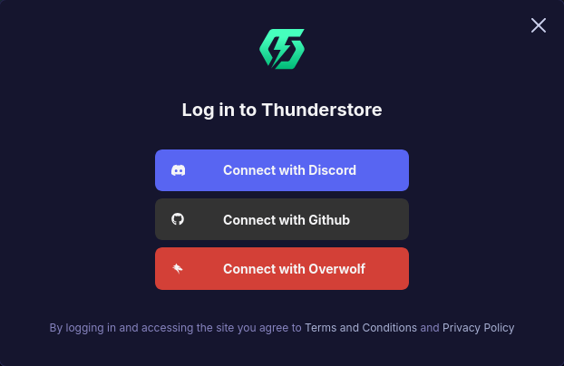
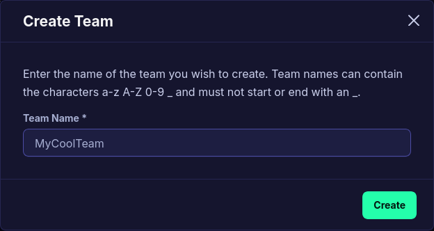
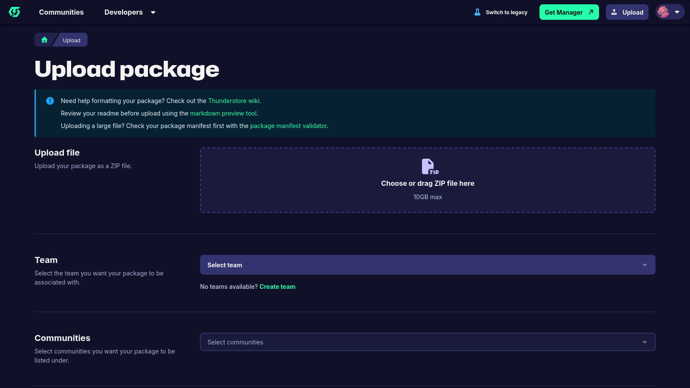

# Uploading to Thunderstore

This page will show you how to package your mod and upload it to [Thunderstore](https://thunderstore.io).

## Package your mod

Go to the [Thunderstore Packager](/create/tools/thunderstore-packager) and follow the instructions to package your mod. Once you finish, download the zipped package file from the bottom button.

## Create a team

First, log in by pressing the button in the top right and selecting your chosen provider.

After you log in, click the button in the top right again and go to Teams. Once you're on the Teams page, click `Create Team` and enter your team name.

This team name is displayed as the author of any mods published under it. If you're making mods by yourself, we recommend you make it the same as your Discord or GitHub username.

## Uploading the package

Inside Thunderstore, click the Upload button in the top left. There, you'll be taken to this page:

Upload your package, select the team you want to publish under, and choose Bopl Battle as the community. Once you select the community, apply fitting categories to your mod.

::: warning

If your mod contains not safe for work (NSFW) content, make sure to mark it accordingly. 
I don't know why a Bopl Battle mod would contain such things, but you do you, I guess.
:::

Once you're finished, submit your mod to Thunderstore.
